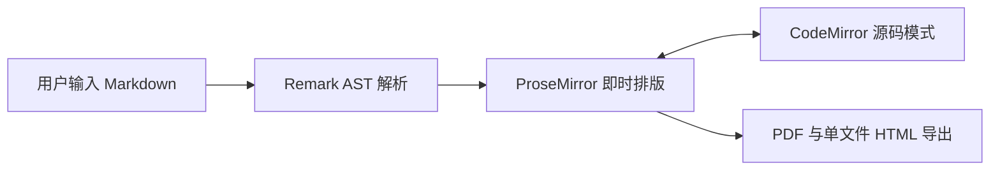
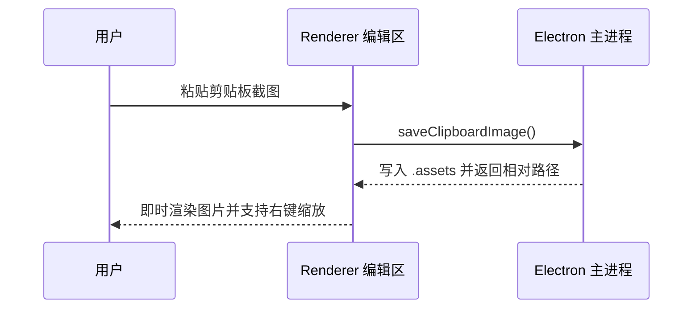
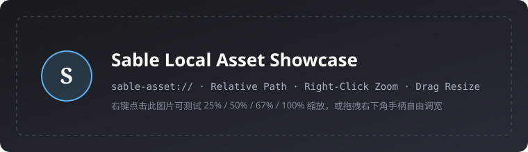

# Sable 全量语法与渲染测试手册

欢迎打开这份完整测试文档。你可以在顶部菜单切换 `GitHub`、`Newsprint`、`Night`、`Minimal` 四套内置主题，按下 `Ctrl + /` 对比 `Source Code Mode`，按下 `F8` 或 `F9` 体验 `Focus Mode` 与 `Typewriter Mode`，也可以打开左侧 `Outline` 面板测试多级标题定位跳转。

[TOC]

---

## 一、多级标题层级测试

下面依次展示一至六级标题的字号、字重与间距表现。

# 一级标题 H1 Typography

## 二级标题 H2 Section

### 三级标题 H3 Subsection

#### 四级标题 H4 Topic

##### 五级标题 H5 Note

###### 六级标题 H6 Caption

---

## 二、段落换行与行内语法测试

### 1. 段落与单换行保留

这是第一个自然段。在 Sable 中按下 `Enter` 会创建独立段落，在 `.md` 源码中以空行分隔，阅读起来呼吸感充足。

下面三行之间只有单个换行符，用于验证打开外部文档或按下 `Shift + Enter` 时的单换行保留效果：
第一行：春江潮水连海平，海上明月共潮生。
第二行：滟滟随波千万里，何处春江无月明。
第三行：中英文与数字混排测试 Sable v0.1.0 running on Electron & Chromium 134。

### 2. 行内标记与光标展开手感

把光标移入下面任意带样式的词内部，可以看到灰阶 Markdown 标记自动展开；光标移出或按方向键右键跨出右边界时，标记会自动收起：

- **加粗强调文本** 与 `__下划线式加粗__` 的渲染测试：**核心结论清晰突出**
- *斜体文本测试*：*The Art of Readable Typography* 与 *中文斜体排版*
- ~~删除线测试~~：~~旧版手动拼接 DOM 方案~~ 已升级为双核架构
- **加粗与*****斜体*****组合嵌套**：***同时具备加粗与斜体***
- 行内代码与中文字体测试：执行 `npm run dev` 启动窗口，点击菜单 `帮助 -> Markdown 语法示例` 查看效果（验证行内代码中的中文不再回退为新宋体）
- 超链接测试：按住 `Ctrl` 并点击访问 [Sable GitHub 仓库](https://github.com/imxuhan/sable)，或点击链接尾部的语法标记修改地址

### 3. 实时输入触发方式速测

你可以在下面的空白处直接动手测试各种输入方式：

1. 顺序输入 `` `hello` ``，敲下第二个反引号瞬间折叠为行内代码，继续打字自动处于代码框外部。
2. 先连续敲两个反引号 ` ` ``，按左方向键把光标移到中间输入字母，也会自动转为行内代码，输完按右方向键即可跨出右边界。
3. 在新行输入 `$$` 加回车、输入 `$$` 加空格，或者直接输入 `$$$$`，都会立即弹出数学公式块编辑框。

---

## 三、列表与引用块测试

### 1. 无序列表与多级嵌套

- 桌面主进程模块
  - 文件原子写入与实时自动保存
  - `chokidar` 外部变更监听
  - `webContents.printToPDF` 静默矢量导出
- 渲染进程编辑器核心
  - `ProseMirror` 即时排版视图
  - `CodeMirror 6` 源码与代码块高亮

### 2. 有序列表

1. 解析本地 `.md` 文件生成 `Remark AST`
2. 映射为 `ProseMirror` 文档树节点并挂载自定义 `NodeView`
3. 编辑变更防抖后序列化回干净的标准 Markdown 文本

### 3. GFM 任务列表（可直接鼠标点击勾选）

- [x] 完成常规系统标题栏与七大顶部原生菜单
- [x] 完成行内语法展开、单换行保留与中文 `IME` 保护
- [x] 完成中英文字体栈优化，避免日文字形混排与 `NSimSun` 回退
- [ ] 点击本行左侧复选框测试勾选与取消勾选交互

### 4. 引用块与嵌套引用

> 好的写作工具应当像一张平整温润的纸和一支顺畅的笔，在你思考时隐去自身的存在，在你需要排版时恰到好处地给出反馈。
>
> > 嵌套引用测试：支持在引用块内部继续使用 **加粗**、`行内代码` 以及行内公式 $e^{i\pi} + 1 = 0$。

---

## 四、数学公式渲染测试（KaTeX）

### 1. 行内公式

在物理与数学笔记中常会穿插行内公式，例如质能方程 $E = mc^2$、勾股定理 $a^2 + b^2 = c^2$、正态分布密度函数 $f(x) = \frac{1}{\sigma\sqrt{2\pi}} e^{-\frac{(x-\mu)^2}{2\sigma^2}}$，以及极限表达式 $\lim_{n \to \infty} \left(1 + \frac{1}{n}\right)^n = e$。点击任意行内公式即可就地编辑源码。

### 2. 块级展示公式（点击下方公式可展开编辑并实时预览）

高斯积分与傅里叶变换对：

$$
\int_{-\infty}^{\infty} e^{-x^2}\,dx = \sqrt{\pi}, \qquad \hat{f}(\xi) = \int_{-\infty}^{\infty} f(x)\, e^{-2\pi i x \xi}\,dx
$$

矩阵与线性方程组排版测试：

$$
\mathbf{A} = \begin{pmatrix}
a_{11} & a_{12} & \cdots & a_{1n} \\
a_{21} & a_{22} & \cdots & a_{2n} \\
\vdots & \vdots & \ddots & \vdots \\
a_{m1} & a_{m2} & \cdots & a_{mn}
\end{pmatrix}, \qquad
\nabla \times \mathbf{B} = \mu_0 \mathbf{J} + \mu_0 \varepsilon_0 \frac{\partial \mathbf{E}}{\partial t}
$$

---

## 五、多语言代码块语法高亮测试

### 1. TypeScript

```typescript
interface DocumentStats {
  words: number
  chars: number
  readingMinutes: number
}

export function summarize(title: string, stats: DocumentStats): string {
  // 中文注释字体渲染测试：清晰无衬线等宽混排
  return `${title}: 共 ${stats.words} 词，预计阅读 ${stats.readingMinutes} 分钟`
}
```

### 2. Python

```python
from pathlib import Path

def scan_markdown_files(workspace: Path) -> list[Path]:
    """扫描工作区目录下的全部 Markdown 文档"""
    return sorted(p for p in workspace.rglob("*.md") if not p.name.startswith("."))
```

### 3. Bash

```bash
cd d:/opentypora
npm run typecheck && npm test && npm run dev
```

---

## 六、可视化表格与对齐测试

将光标点击进入下方表格任意单元格，表头上方会浮现行列增删与对齐工具条，按 `Tab` 与 `Shift + Tab` 可在单元格间快速跳转：

| 功能模块 | 左对齐列示例 | 居中列示例 | 右对齐数值列 |
| :--- | :--- | :---: | ---: |
| 即时渲染内核 | 支持 `**加粗**` 与 `行内代码` | `ProseMirror` | 100% |
| 数学公式渲染 | 支持行内 $\alpha + \beta$ 公式 | `KaTeX` | 0.8 ms |
| 跨行单元格测试 | 第一行说明<br />第二行补充说明 | `GFM Table` | 2,048 KB |
| 矢量导出管线 | 静默输出书签与主题背景 | `printToPDF` | 60 FPS |

---

## 七、Mermaid 图表实时渲染测试

点击下方任意图表即可展开源码框并实时修改预览：





---

## 八、本地相对路径图片与缩放测试

### 1. 原始 100% 比例本地图片



### 2. 50% 缩放持久化示例（右键点击图片可切换比例或拖拽右下角调整宽度）

